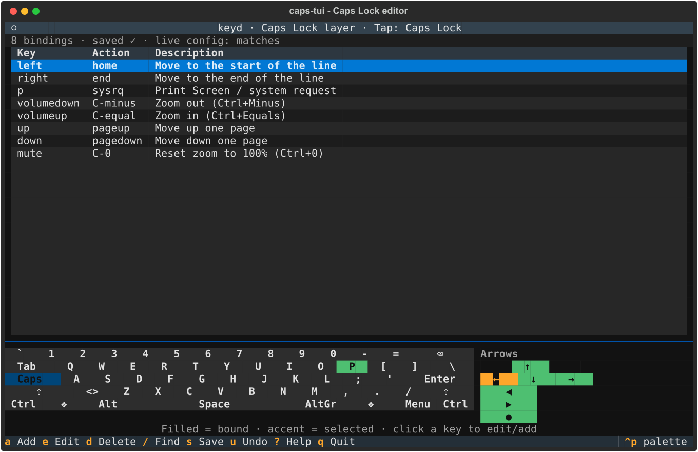
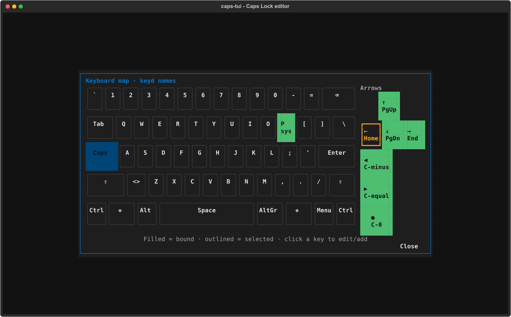
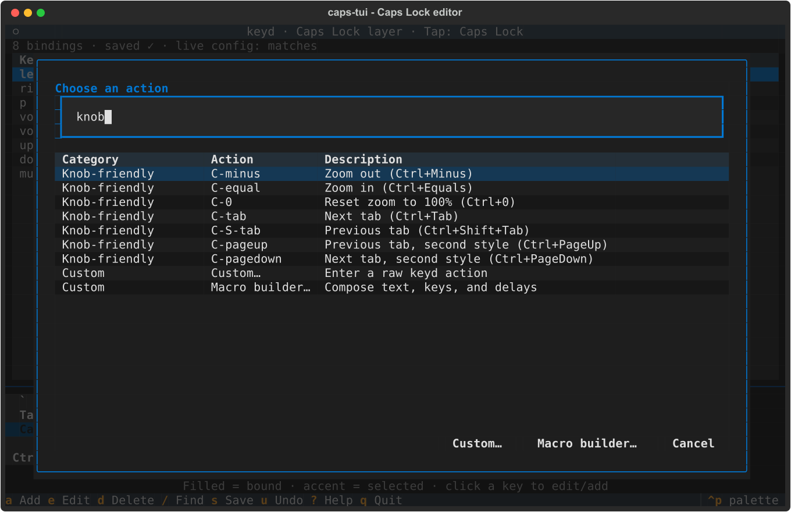
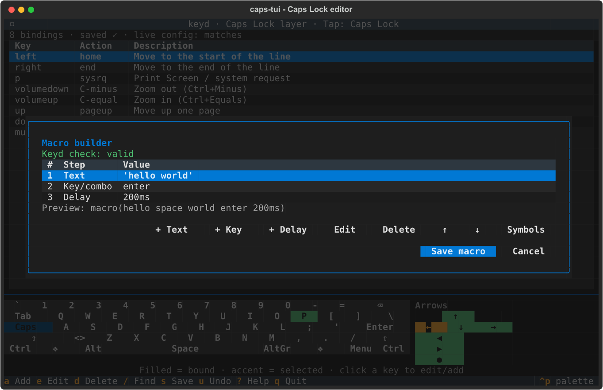
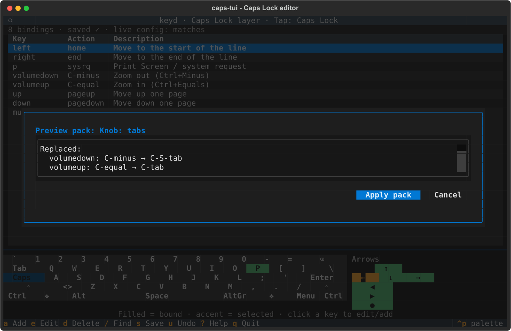
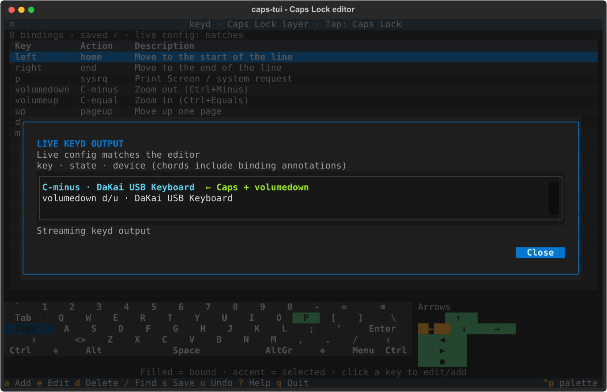
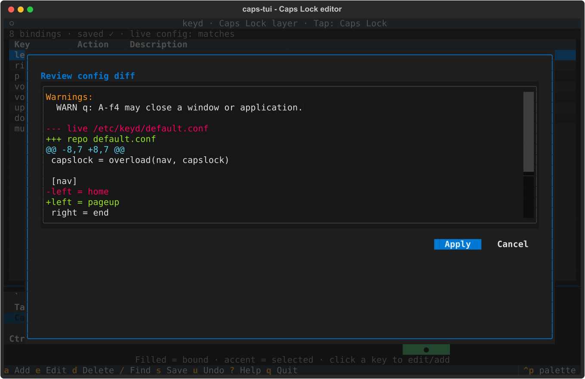
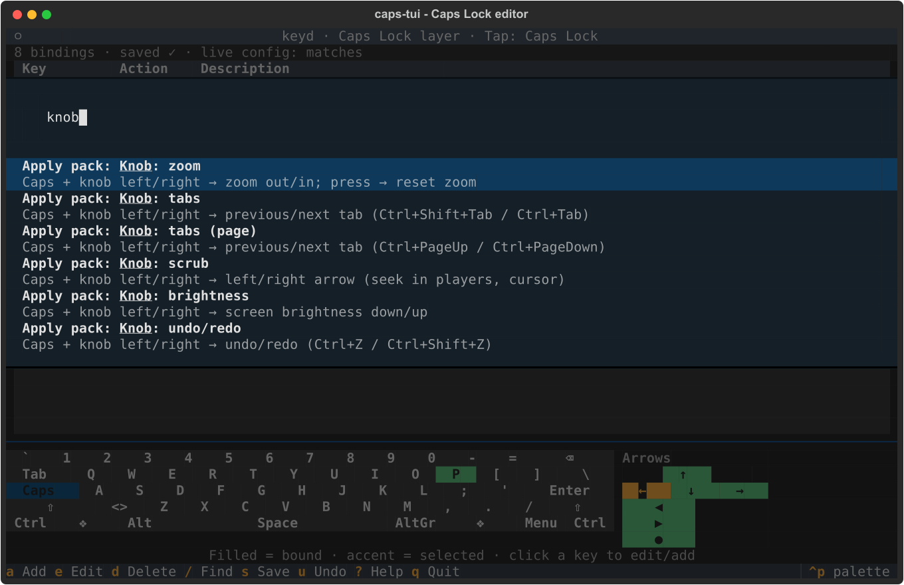

# caps-tui
[](https://github.com/DarkoKuzmanovic/caps-tui/actions/workflows/selftest.yml) [](LICENSE)

A Textual terminal UI for editing the keyd Caps Lock layer and its tap action.



## Features

- Browse the `[nav]` bindings and click a key in the keyboard map to add or edit it.
- Add, edit, and delete bindings; capture a physical key with `keyd monitor` or type its keyd name.
- Search bindings and filter the categorized action picker by action, description, or category. Use **Custom…** for a raw keyd action or open the macro builder.
- Preview and merge preset packs, including packs for keyboard volume knobs.
- Set the short Caps press action in `[main]`, independently of the hold-to-use `[nav]` layer.
- See risky bindings, undo/redo edits, preview a live-config diff, and load `[nav]` bindings from a timestamped backup.
- Open a live keyd output panel that composes modifier events into chords and annotates matching bindings.
- Use the clickable keyboard map, command palette (`Ctrl+P`), or headless Python CLI.

## Screenshots

Captured from the real Textual app with a temporary config and simulated monitor events; no live keyd config was changed.

| Keyboard map | Filtered action picker |
| --- | --- |
|  |  |

| Macro builder | Preset pack preview |
| --- | --- |
|  |  |

| Live keyd output | Config diff review |
| --- | --- |
|  |  |

| Command palette |
| --- |
|  |


## Requirements

- Linux with [keyd](https://github.com/rvaiya/keyd) **2.6 or newer** for config validation, key capture/live output, and applying a config. The editor can open without keyd, but those integrations are unavailable.
- Python **3.12+** and [uv](https://docs.astral.sh/uv/) to run the Textual UI. `keymap.py` declares Textual as a PEP 723 inline dependency, so uv supplies it without a project-wide install.
- Rust **1.88+** to build the GUI (`caps-gui/`), which links [Rune](https://github.com/anomalyco/rune).
- `sudo` for key capture/live monitoring and for installing or reloading `/etc/keyd/default.conf`.

## GUI (Rune)

`caps-gui/` is a native window on [Rune](https://github.com/anomalyco/rune): the same `[nav]` layer, the same keyboard map, the same packs and macros, without a terminal.

```sh
cargo run -p caps-gui            # the window
cargo run -p caps-gui -- list    # the same commands as keymap.py
cargo test --no-default-features # the core, no GPU stack needed
```

| Key | Action |
| --- | --- |
| `↑`/`↓`, `j`/`k` | Move through the bindings |
| `/` | Filter by key, action or description |
| `Enter` / `e` | Pick an action for the selected binding |
| `a` | Capture a key by pressing it, then pick its action |
| `d` | Delete the binding |
| `t` | Short Caps press action |
| `p` | Preset packs, previewed before they merge |
| `b` | Timestamped backups, previewed before they load |
| `l` | Live `keyd monitor` panel |
| `A` | Review the live/editor diff (warnings first) and apply |
| `s` | Validate with `keyd check` and save |
| `u` / `U` | Undo / redo |
| `q` | Quit |

Every commit — a picked action, a custom action, a macro, a tap, a pack, a backup — renders the candidate config and asks `keyd check` first; a rejection keeps the editor open with the reason.

Clicking a cap on the map selects its binding, or opens the picker when the key has none.

**Applying from a window.** A `.desktop` launch has no terminal, so `sudo` cannot prompt. `A` goes through two root-owned helpers in `/usr/libexec` (`caps-gui-monitor`, `caps-gui-apply`) authorised by one polkit action, installed with `sudo bash install.sh --install-policy`. The apply helper takes the config on stdin, validates a temp copy **before** `/etc/keyd` is touched, then backs up, installs and reloads; it never executes a file from this repository. The action is `auth_admin`, so every apply asks.

**Building it.** Rune is pinned to a `dev` rev. It vendors five patched crates and its own note says apps must patch them too, so the workspace root carries the same `[patch.crates-io]` entries pointed at that rev — cargo finds the vendored packages by name, so no sibling checkout is needed. `cargo test --no-default-features` skips Rune entirely.

The Textual TUI stays the reference until the GUI has feature parity; both read the same `default.conf`.

## Install & first run

```sh
git clone https://github.com/DarkoKuzmanovic/caps-tui.git
cd caps-tui
./keymap.py
```

If you prefer to invoke uv explicitly:

```sh
uv run keymap.py
```

The first UI launch may download Textual from the inline dependency metadata. The editor starts from this checkout's `default.conf`; it does not change the live keyd config until you confirm an apply. The headless CLI and `--selftest` do not need Textual.

## Configure your keyboard

The shipped [`default.conf`](default.conf) targets one specific device:

```ini
[ids]
0e6a:02c0
```

That VID:PID is for the DaKai/Defender keyboard used to prepare the example. **Change `[ids]` before applying** so it matches your keyboard. Get its VID:PID from `lsusb` or the device field in `keyd monitor`. Use your device's `vvvv:pppp` value for a specific keyboard; keyd also accepts `*` to match all keyboards, which can affect every keyboard keyd handles.

The default config uses Caps as a momentary layer key, with Caps Lock sent on a short tap:

```ini
[main]
capslock = overload(nav, capslock)

[nav]
left = home
right = end
p = sysrq
volumedown = C-minus
volumeup = C-equal
up = pageup
down = pagedown
mute = C-0
```

Change the `overload(nav, …)` tap action in the UI with **Tap** (`t`), or edit `[main]` directly. The UI supports Caps Lock, Esc, Backspace, and a custom keyd action. It only edits a tap setting when it recognizes a single `capslock = overload(nav, action)` entry; other `[main]` forms are shown read-only rather than rewritten.

## Usage

The main table lists each key, keyd action, and action description. Type `/` to filter by key, action, or description; `Esc` clears the filter. The action picker has category and description filtering, plus **Custom…** and **Macro builder…**. The inline keyboard map appears at terminal sizes of at least 80×30; use **Map** (`m`) to open the full clickable map at any size. Bound keys are highlighted, and clicking a key starts editing that binding (or adds a new one).

| Key | Action |
| --- | --- |
| `a` | Add a binding: capture/type a key, then choose its action |
| `e` / `Enter` | Edit the selected binding |
| `d` | Delete the selected binding |
| `/` | Find bindings; `Enter` keeps the filter, `Esc` clears it |
| `l` | Open the live keyd output panel |
| `p` | Choose and preview a preset pack |
| `b` | Preview and load `[nav]` bindings from a backup |
| `t` | Change the Caps tap action |
| `m` | Open the keyboard map |
| `s` | Validate, review the live diff, then apply if confirmed |
| `u` / `Ctrl+R` | Undo / redo |
| `Ctrl+P` | Open the command palette |
| `?` | Show in-app help |
| `q` | Quit; unsaved edits require confirmation |
| `↑` / `k`, `↓` / `j` | Move through the selected table |

### Key capture

When adding a binding, the editor runs `sudo keyd monitor` to capture the next key-down event. **Press the key by itself—do not hold Caps.** keyd grabs matched devices, so the monitor reports keyd's virtual keyboard output after remapping, not necessarily the physical key press. Press `Ctrl+T` to type a keyd name instead (use this for a key name or chord such as `leftcontrol` or `C-minus`); `Ctrl+G` cancels. A sudo password prompt temporarily suspends the UI while authentication runs.

## Command-line reference

Run commands with `python3 keymap.py`; they edit the checkout's `default.conf` and do not import Textual. Changes are validated when keyd is available. The editing commands save locally; add `--apply` to proceed to the apply flow, and `-y`/`--yes` to skip its confirmation prompt.

| Command | Purpose |
| --- | --- |
| `python3 keymap.py list` | Show bindings, tap action, and warnings |
| `python3 keymap.py add KEY ACTION [--apply] [-y]` | Add or replace a binding |
| `python3 keymap.py rm KEY [--apply] [-y]` | Remove a binding |
| `python3 keymap.py tap ACTION [--apply] [-y]` | Set the short Caps press action |
| `python3 keymap.py packs` | List preset packs |
| `python3 keymap.py pack NAME [--apply] [-y]` | Merge a pack by exact name or unique case-insensitive prefix |
| `python3 keymap.py diff` | Compare this checkout with the live config |
| `python3 keymap.py check` | Validate `default.conf` with `keyd check` |
| `python3 keymap.py apply [-y]` | Review the diff, confirm, and install/reload |
| `python3 keymap.py --selftest` | Run the built-in checks |
| `uv run keymap.py --uitest` | Run headless Textual UI flows |

`diff` returns **0** when configs match, **1** when they differ, and **2** when the live config cannot be read. A missing live file is treated as unreadable for this command; the apply flow instead reports that it will create it.

## How applying works

In the UI, **Save** (`s`) first validates the edited config, shows binding risk warnings, and previews the diff between the live config and this checkout. Cancel leaves the edits unsaved. If the config already matches live, the editor saves locally without invoking sudo. Otherwise, confirming applies the config:

- If keyd is installed and its service is active, the app runs `sudo bash install.sh --reload`. This backs up a differing `/etc/keyd/default.conf`, installs the checkout's `default.conf`, runs `keyd check`, then reloads keyd.
- Otherwise, the full `bash install.sh` path uses `pacman` to install keyd, backs up a differing config, checks it, enables/starts the service, and restarts it. **This full install path is for Arch Linux.**

On a non-Arch distribution, install keyd using its own documentation and enable/start the service first; then use `sudo bash install.sh --reload` or `python3 keymap.py apply` (the CLI selects the reload path when keyd is active). The `--reload` path requires keyd to already be installed and running.

Timestamped backups are stored beside the live config as `default.conf.bak.YYYY-MM-DD-HHMMSS` (normally `/etc/keyd`). In the UI, **Backup** (`b`) previews a backup and loads only its `[nav]` bindings into the editor; it does not immediately restore the entire file. Review and apply the loaded bindings as usual.

## Volume knobs and media keys

keyd exposes many keyboard knobs as `volumedown`, `volumeup`, and `mute`, so the `Knob: …` preset packs bind Caps plus those events to zoom, tab navigation, scrubbing, brightness, or undo/redo. The included device's knob emits those consumer-control keys. Your keyboard may expose different names; inspect `keyd monitor` and choose a matching `[ids]` entry. The action catalog also includes media playback and brightness actions.

## Macros and Unicode

Choose **Macro builder…** in the action picker to compose text, a key/key combo, and delays (0–1023 ms). Steps can be edited, reordered, deleted, and previewed; the builder validates the result with `keyd check`. **Symbols** inserts common characters into a text step. `Custom…` accepts any keyd action, including raw `macro(...)` syntax.

For Unicode text, install keyd's Compose data (usually `/usr/share/keyd/keyd.compose`) and include it from `~/.XCompose`, for example:

```text
include "/usr/share/keyd/keyd.compose"
```

Use the default US display layout for keyd's Unicode output. Some applications may need to be restarted before they use the Compose configuration.

## Live test panel

Press `l` to stream `keyd monitor` output without applying editor changes. Modifier events are composed per device into keyd-style chords (`leftcontrol` + `minus` becomes `C-minus`), and output matching a configured action is annotated with the binding that produced it. The panel also reports whether the live config matches the editor. Because keyd grabs matched devices, this is keyd's post-remap virtual output—not a raw hardware event log. Monitoring uses sudo; a password prompt suspends the terminal UI until authentication completes.

## Safe testing & development

```sh
python3 keymap.py --selftest
uv run keymap.py --uitest
```

`--selftest` checks the config, actions, packs, macro encoding, and editor rules; keyd-dependent validation is skipped when keyd is unavailable. `--uitest` drives the Textual app headlessly and saves review SVGs under `/tmp`. CI runs `--selftest` (keyd checks are skipped on the runner because keyd isn't installed) and the headless `--uitest` on every push/PR.

For isolated tests, point the live-config and backup lookup at a temporary directory and provide a fake monitor command rather than touching `/etc/keyd` or invoking real sudo:

| Variable | Effect |
| --- | --- |
| `KEYMAP_ETC` | Use this directory instead of `/etc/keyd` for live config and backups |
| `KEYMAP_MONITOR_CMD` | Run this command instead of `sudo -n keyd monitor` |
| `KEYMAP_MONITOR_TIMEOUT` | Set the capture timeout in seconds (default: 10) |
| `KEYD_BIN` | Override the path to the `keyd` executable |

The UI test suite demonstrates the temporary `KEYMAP_ETC` and fake monitor setup in [`keymapper/uitest.py`](keymapper/uitest.py). Project layout: `keymap.py` is the uv/CLI entry point; `keymapper/` contains config, keyd integration, rules, macros, and CLI logic; `keymapper/tui/` contains the Textual app and screens.

## Troubleshooting

- **The UI says keyd is missing:** install keyd using your distribution's instructions. Without it, keyd validation is skipped and capture, live monitoring, and apply are unavailable.
- **Capture or apply appears to pause:** sudo may be waiting for your password. The terminal UI is suspended while the prompt is shown; complete it in the terminal.
- **A captured key is not the physical key I pressed:** keyd grabs matching devices and `keyd monitor` shows the virtual output after remapping. Capture without Caps, or press `Ctrl+T` and type the intended keyd name.
- **I need a valid key name:** inspect `keyd list-keys` and `keyd monitor`; keyd's names are used in the config and action picker.
- **Textual is missing:** launch the UI with `uv run keymap.py` (or `./keymap.py`) so uv resolves the inline dependency.
- **The config targets the wrong device:** change `[ids]` in `default.conf` from the example VID:PID to your keyboard's ID before applying.

## License

[MIT](LICENSE).
